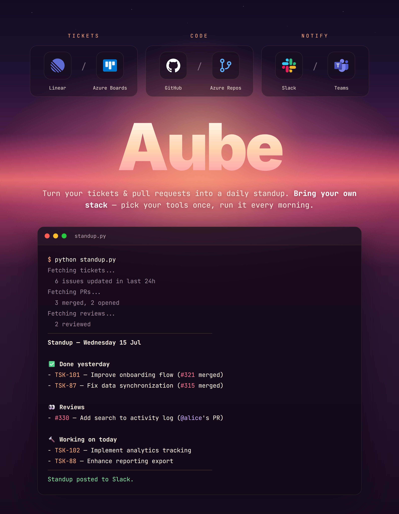

<div align="center">


# Aube

Fetches your tickets & pull requests, composes a daily standup, and posts it (or prints it to your terminal). Bring your own stack.

<p>
  
  
  
  
  
  
</p>



</div>

## What it does

- **Done** — completed tickets + merged PRs
- **Reviews** — PRs you reviewed (not your own)
- **In progress** — started tickets + open PRs
- **Blockers** — tickets with "block" in the title
- **Ticket ↔ PR pairing** — when the ticket ID appears in the PR title or description
- **Monday-aware** — lookback goes back to Friday
- **Pick your stack** — tickets (Linear or Azure DevOps Boards), code (GitHub or Azure DevOps Repos), and notification channel (Slack, Teams, or none) are chosen once at install time, in any combination

## Setup

**macOS / Linux:**

```bash
git clone https://github.com/0LrNx/aube.git
cd aube
python3 -m venv .venv && source .venv/bin/activate
pip install -r requirements.txt
python install.py
```

**Windows (PowerShell):**

```powershell
git clone https://github.com/0LrNx/aube.git
cd aube
python -m venv .venv
.\.venv\Scripts\Activate.ps1
pip install -r requirements.txt
python install.py
```

`install.py` asks which ticket source, code source, and notification channel you use, and writes the answers to `.env`. Prefer to configure by hand? Copy `.env.example` to `.env` and fill it in yourself — see that file for which variables each provider needs.

```bash
python standup.py
```

**Review before posting** — the tool can't guess what you'll work on today. Add `--review` to drop irrelevant items, add today's work and blockers, and confirm before anything is posted:

```bash
python standup.py --review
```

Scheduled runs stay fully automatic: just leave `--review` out.

**Scheduling** (weekdays 9am):

macOS/Linux, via cron:

```
0 9 * * 1-5 cd /path/to/aube && .venv/bin/python standup.py
```

Windows, via Task Scheduler — PowerShell (no admin rights needed for a task on your own account):

```powershell
$dir = "C:\path\to\aube"
$action = New-ScheduledTaskAction -Execute "$dir\.venv\Scripts\python.exe" -Argument "standup.py" -WorkingDirectory $dir
$trigger = New-ScheduledTaskTrigger -Weekly -DaysOfWeek Monday,Tuesday,Wednesday,Thursday,Friday -At 9am
$settings = New-ScheduledTaskSettingsSet -StartWhenAvailable -WakeToRun -DontStopIfGoingOnBatteries -AllowStartIfOnBatteries
Register-ScheduledTask -TaskName "Aube" -Action $action -Trigger $trigger -Settings $settings -Description "Generates the daily standup"
```

`-WorkingDirectory` matters: it's how `standup.py` finds your `.env`. `-WakeToRun` wakes the PC from sleep at 9am (wake timers must be allowed in your power options), and `-StartWhenAvailable` catches up a missed run the next time the PC is on — only once, however many days were missed.

The task runs only while you're logged in (a locked screen counts). To run it after a logout too, open the task in Task Scheduler and pick "Run whether user is logged on or not"; you'll have to re-enter your password there each time your Windows password changes.

Check it, or run it now:

```powershell
Get-ScheduledTaskInfo -TaskName "Aube" | Select-Object LastRunTime, LastTaskResult, NextRunTime
Start-ScheduledTask -TaskName "Aube"
```

Going on holiday? `Disable-ScheduledTask -TaskName "Aube"`, then `Enable-ScheduledTask` when you're back.

**Shortcut command (Windows)** — add an `aube` function to your PowerShell profile (`notepad $PROFILE`) to run it from any folder:

```powershell
# Aube: daily standup. "aube" = interactive review; "aube -Post" = post directly, no questions.
function aube {
    param([switch]$Post)
    $dir = "C:\path\to\aube"
    $python = "$dir\.venv\Scripts\python.exe"
    if ($Post) {
        & $python "$dir\standup.py"
    } else {
        & $python "$dir\standup.py" --review
    }
}
```

Reload with `. $PROFILE`, or open a new terminal. If you move or rename the repo folder, update `$dir` in both the profile and the scheduled task.

## Tokens

- **GitHub** — [Settings → Tokens (classic)](https://github.com/settings/tokens), `repo` scope
- **Linear** — [Settings → API](https://linear.app/settings/api) → Personal API keys
- **Azure DevOps** — [Organization settings → Personal access tokens](https://dev.azure.com/), scopes: Work Items (Read) and Code (Read)
- **Slack** — [api.slack.com/apps](https://api.slack.com/apps) → Incoming Webhooks → add to workspace
- **Teams** — in your channel, create a Workflow from the template "Post to a channel when a webhook request is received" and copy its URL (legacy "Incoming Webhook" connector URLs still work too)

Everything runs locally. Tokens stay in your `.env`.

## Development

```bash
pip install -r requirements-dev.txt
pytest
ruff check .
```

Dependencies are pinned in `requirements.txt` / `requirements-dev.txt`. To upgrade, bump a version, reinstall, and re-run the tests.

Values already set in your environment take precedence over `.env`.

The README banner (`images/aube.png`) is rendered from `images/banner/banner.html`. After editing it, regenerate the PNG (3200×4120, rendered at 2× for sharp text) with headless Chrome, from the repo root in PowerShell:

```powershell
& "C:\Program Files\Google\Chrome\Application\chrome.exe" --headless=new --hide-scrollbars --force-device-scale-factor=2 --window-size=1600,2060 --virtual-time-budget=8000 --allow-file-access-from-files --screenshot="$PWD\images\aube.png" "file:///$($PWD -replace '\\','/')/images/banner/banner.html"
```

## Credits

Aube builds on [linear-github-standup](https://github.com/y2-znt/linear-github-standup) by [@y2-znt](https://github.com/y2-znt), extending the original Linear + GitHub + Slack tool with pluggable provider stacks (Azure DevOps Boards/Repos, Microsoft Teams) and an interactive installer.
